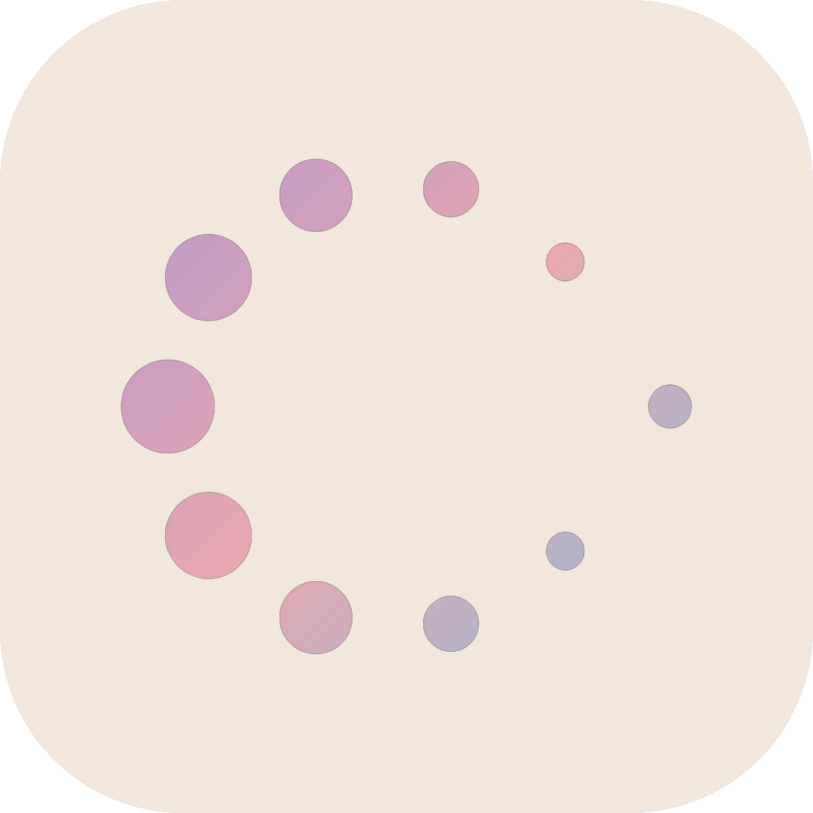
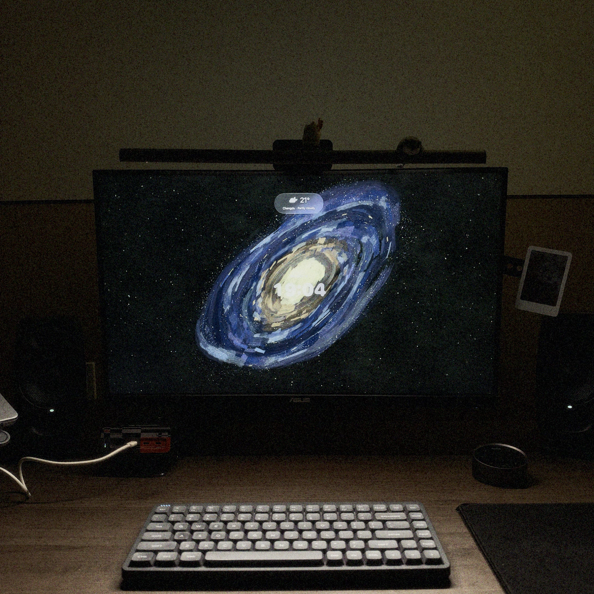

<h2 align="center">
  Swell: Art &amp; Clock&nbsp;
  
</h2>

English · [简体中文](README.zh-CN.md)

**Digital art and clocks for your Mac.**

Swell turns your display into a full-screen canvas: animated artwork, your own videos, or a pixel gallery made from your photos. Add a clock, see what's playing in Music, or bring the weather into view.

## Try the beta

**[Join the Swell TestFlight beta →](https://testflight.apple.com/join/nZGUq3mh)**

Install Apple's TestFlight app on your Mac, then open the invitation link to install Swell. Swell is currently in beta; features and appearance may change between builds.

## A look at Swell

### Blue · Clear Glass clock

### Saturn’s Halo and Pixellery

| Saturn’s Halo · Clear Glass clock | Pixellery · Photo gallery |
| --- | --- |
|  |  |

The three images above are actual app screenshots.

### In your space

## Three ways to fill your screen

| Module | What it does |
| --- | --- |
| **Lumina** | Explore 15 built-in animated themes, from flowing color and soft morning light to orbital lines and annual progress. |
| **Cinema** | Import your MP4 and MOV videos, organize them into folders, and play them full screen. |
| **Pixellery** | Turn JPEG, PNG, and HEIC photos into a pixel gallery with animated transitions. A built-in collection is available before you import anything. |

- **Clocks:** choose Flip or Clear Glass in Lumina and Pixellery. Set 12/24-hour time, seconds, date, and size. Cinema has its own clock layout; Dot Progress uses its own time visualization.
- **Music:** an optional widget shows the current track, artist, available artwork, and playback progress from the Music app on your Mac.
- **Weather:** optional weather in supported Lumina themes and Pixellery, with offline city search or a one-time location request.
- **Multiple displays:** play artwork across connected displays, with the clock and information on the main display.
- **Playback controls:** choose a motion profile for supported artwork and optionally keep your display awake during full-screen playback.

Built-in artwork and local media playback work offline. Music information and cover artwork are read from the local Music app; missing covers show a placeholder. Weather updates require an internet connection. The app stores preferences and imported media locally and has no advertising or usage analytics SDK.

## Requirements

- An Apple Silicon Mac.
- macOS 15 or later.
- Apple's TestFlight app to install the beta.

Clear Glass uses native Liquid Glass on macOS 26 or later and a material appearance on macOS 15. Music access and current-location weather are optional and ask for macOS permissions when used.

## Get started

1. Install Swell through the [TestFlight invitation](https://testflight.apple.com/join/nZGUq3mh).
2. Choose **Lumina**, **Cinema**, or **Pixellery**. Select a theme or import your media.
3. Open **Adjust** to configure the available clock, artwork, Music, weather, and playback options.
4. Click **Full Screen** or press **⌘ Return**. Press **Esc** to return to the gallery.

During full-screen playback, **Page Up** and **Page Down** switch to the previous or next available theme or media item.

## Support and privacy

- [User guide and troubleshooting](docs/support.en.md)
- [Privacy policy](docs/privacy.en.md)
- [Report a bug or suggest a feature](https://github.com/Whaleer/Swell/issues)

GitHub issues, comments, and attachments are public. Please remove private information before posting.

## About this repository

This is Swell's public product and support repository. Swell is proprietary software; its application source code is private. This repository contains product information, screenshots, and user documentation.

Developed by Bingxi Liu. See [Copyright and rights](COPYRIGHT.md).
