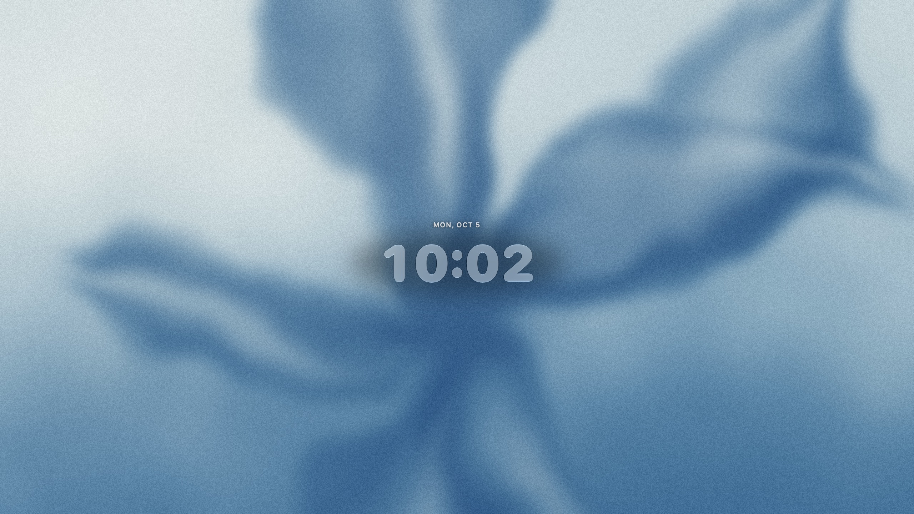
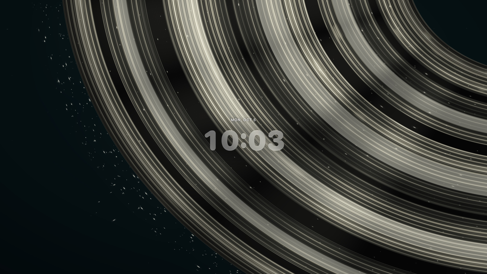
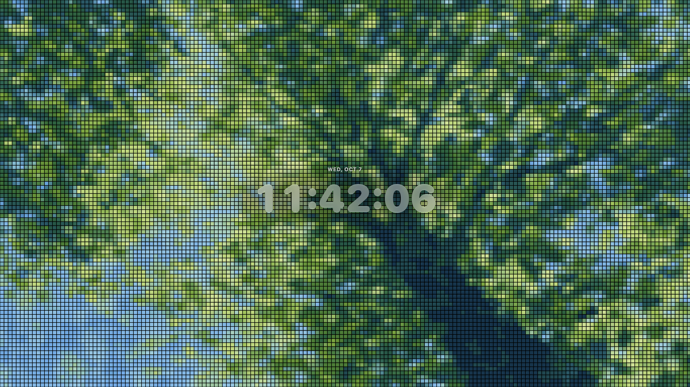
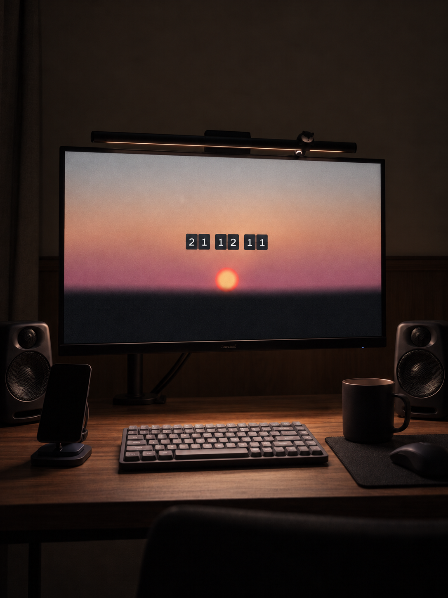

# Swell: Art & Clock

[English](README.md) · 简体中文

**为 Mac 带来数字艺术与时钟。**

Swell 将屏幕变成全屏画布：欣赏动态艺术、播放自己的视频，或把照片变成像素画廊。你还可以添加时钟，查看 Music 正在播放的曲目，或显示天气。

## 体验测试版

**[加入 Swell TestFlight 测试 →](https://testflight.apple.com/join/nZGUq3mh)**

先在 Mac 上安装 Apple 的 TestFlight 应用，再打开邀请链接安装 Swell。目前 Swell 处于测试阶段，不同构建的功能与外观可能有所变化。

## 看看 Swell

### Blue · Clear Glass 时钟

### Saturn’s Halo 与 Pixellery

| Saturn’s Halo · Clear Glass 时钟 | Pixellery · 照片画廊 |
| --- | --- |
|  |  |

以上三张图片均为应用真实截图。

### 放进你的桌面空间

*AI 生成场景示意。屏幕与硬件细节可能与实际应用及设备不同。*

## 三种全屏体验

| 模块 | 用途 |
| --- | --- |
| **Lumina** | 探索 15 个内置动态主题，从流动色彩、柔和晨光，到轨道线条与年度进度。 |
| **Cinema** | 导入 MP4、MOV 视频，按文件夹整理并全屏播放。 |
| **Pixellery** | 将 JPEG、PNG、HEIC 照片转成带动态转场的像素画廊；尚未导入照片时也有内置画作可供欣赏。 |

- **时钟：**在 Lumina 和 Pixellery 中选择 Flip 翻页或 Clear Glass 清透样式，设置 12／24 小时制、秒数、日期和大小。Cinema 使用自己的时钟布局；Dot Progress 使用独立的时间可视化。
- **音乐：**可选小组件从本机 Music 读取当前曲目、歌手、可用封面与播放进度。
- **天气：**在支持的 Lumina 主题和 Pixellery 中开启天气，使用离线城市搜索，或主动请求一次当前位置。
- **多显示器：**在连接的显示器上播放艺术画面，时钟与信息显示在主显示器。
- **播放控制：**为支持的艺术主题选择动态速度，并可在全屏播放期间保持显示器唤醒。

内置艺术与本地媒体播放可离线运行。音乐信息和封面仅从本机 Music 读取，缺失封面时显示占位图；天气更新需要联网。偏好与导入媒体保存在本地，应用没有广告或使用情况分析 SDK。

## 系统要求

- Apple Silicon Mac。
- macOS 15 或更新版本。
- 安装测试版需要 Apple 的 TestFlight 应用。

Clear Glass 在 macOS 26 及更新版本使用原生 Liquid Glass，在 macOS 15 使用材质兼容外观。音乐读取和当前位置天气均为可选功能，使用时按需请求 macOS 权限。

## 快速开始

1. 通过 [TestFlight 邀请链接](https://testflight.apple.com/join/nZGUq3mh)安装 Swell。
2. 选择 **Lumina**、**Cinema** 或 **Pixellery**，挑选主题或导入媒体。
3. 打开 **Adjust**，调整可用的时钟、画面、音乐、天气和播放选项。
4. 点击 **Full Screen** 或按 **⌘ Return** 开始全屏播放；按 **Esc** 返回画廊。

全屏播放期间，**Page Up** 和 **Page Down** 可切换到上一个或下一个可用主题或媒体项目。

## 支持与隐私

- [使用指南与常见问题](docs/support.zh-CN.md)
- [隐私政策](docs/privacy.zh-CN.md)
- [反馈问题或提出建议](https://github.com/Whaleer/Swell/issues)
- 邮箱：[1004707367@qq.com](mailto:1004707367@qq.com)

GitHub Issue 是公开的。包含私人信息的支持请求请通过邮件发送。

## 关于这个仓库

这里是 Swell 的公开产品与支持仓库。Swell 是闭源软件，应用源码保持私有；本仓库提供产品介绍、截图与用户文档。

开发者：Bingxi Liu。详见[版权与权利说明](COPYRIGHT.md)。
